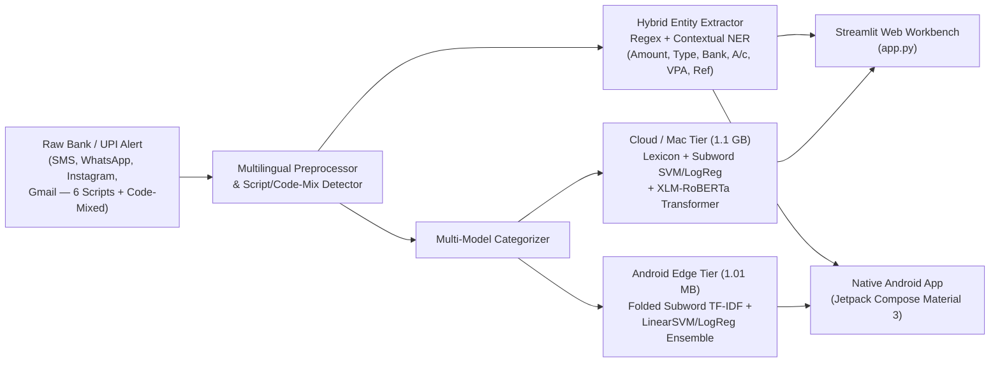

# Robust NLP Framework for Automated Financial Transaction Extraction and Expense Categorization

**School of Computer Science and Engineering — RV University**  
**Team ID: 10**

| Student Name | USN |
| :--- | :--- |
| **Preksha P V** | `1RUA24CSE0331` |
| **Reshma K P** | `1RUA24CSE0363` |
| **Prathik K B** | `1RUA24CSE0327` |
| **Rushil Ravi Reddy** | `1RUA24CSE0380` |

**Project Guides:** Prof. Khushboo Pandey & Prof. Priyanka S Shivaramaiah  
**Dataset:** [`Ranjit0034/finee-dataset`](https://huggingface.co/datasets/Ranjit0034/finee-dataset) (152,000+ Indian Banking & UPI Messages across 6 Indian Languages + Code-Mixed Augmentation)

---

## 🎯 Project Objectives (Aligned with Synopsis)

1. **Automated Financial Entity Extraction:** Programmatically extract structured transaction details (**Transaction Amount, Merchant/Beneficiary Name, Date, Transaction Type [Debit/Credit], Bank Name, Masked Account/Card Number, UPI VPA, Reference ID, and Payment Mode**) from bank and UPI SMS/notification messages.
2. **Automated Expense Categorization:** Classify transactions into fine-grained FinEE categories (`food`, `grocery`, `shopping`, `transport`, `travel`, `bills`, `entertainment`, `healthcare`, `education`, `investment`, `emi`, `transfer`, `salary`) and map them to the **Synopsis Core Categories** (**Food & Dining, Shopping, Travel & Transport, Bills & Utilities, Healthcare, Education, Investments & Wealth, Entertainment & Lifestyle, P2P Transfers, and Income & Salary**).
3. **Multilingual & Code-Mixed Support:** Native support for **English (`en`)**, **Hindi (`hi` — हिंदी)**, **Kannada (`kn` — ಕನ್ನಡ)**, **Tamil (`ta` — தமிழ்)**, **Telugu (`te` — తెలుగు)**, **Bengali (`bn` — বাংলা)**, and **Romanized Code-Mixed (`hinglish` / `kanglish` / `tanglish`)** banking messages (e.g., *"Aapke HDFC khate XX4248 se Rs.485.50 kat gaya for Swiggy payment"*).
4. **Dual Deployment (Mac Web Workbench + 100% Offline Android Jetpack Compose App):**
   - **Desktop / Cloud Workbench (`app.py`):** Interactive Streamlit dashboard running the full **Hybrid Ensemble (`xlm-roberta-base` Transformer + Subword SVM/LogReg + Lexicon)** on Apple Silicon (`mps`) / CUDA with Explainable AI (XAI) token attributions.
   - **On-Device Android App (`android_app/`):** Standalone **Jetpack Compose (Material 3 Expressive)** mobile app running the exported **1.01 MB** Colab-trained Subword TF-IDF + SVM/Logistic Regression Ensemble in pure Kotlin (`< 1.5 ms` latency, 100% offline, zero server required).

---

## 🏗️ System Architecture



---

## 📂 Project Directory Structure

```text
NLP/
├── app.py                          # Interactive Streamlit Expense Tracker & NLP Workbench (Mac/Cloud)
├── train_and_evaluate.py           # End-to-End Dataset Loader, Model Trainer & Evaluator
├── requirements.txt                # Project Python dependencies
├── README.md                       # Project documentation and usage guide
├── src/
│   ├── __init__.py
│   ├── config.py                   # Categories, Indian bank aliases, multilingual lexicons
│   ├── preprocessor.py             # Script detection, code-mix detection & text normalization
│   ├── extractor.py                # Hybrid Regex + Contextual NER entity extraction engine
│   ├── data_loader.py              # FinEE HF dataset fetcher + Code-Mixed & Education augmentation
│   ├── categorizer.py              # Rule-based, Subword SVM, LightGBM, Transformer & Hybrid Ensemble
│   └── evaluator.py                # Precision, Recall, F1 & Confusion Matrix evaluation suite
├── notebooks/
│   ├── Colab_Pro_FinEE_Complete_Pipeline.ipynb # Full GPU Training Pipeline & Model Exporter
│   └── FinEE_NLP_Framework_Walkthrough.ipynb   # Interactive Jupyter Notebook walkthrough
├── android_app/                    # 100% Native Jetpack Compose (Material 3) Offline Android App
│   └── app/src/main/
│       ├── assets/finnlp_model.json            # Exported Colab TF-IDF + SVM/LogReg weights (1.01 MB)
│       └── java/com/rvu/finnlp/
│           ├── MainActivity.kt                 # Jetpack Compose UI, NER BottomSheet, CSV Export, VPA Memory
│           ├── FinNlpEngine.kt                 # Pure Kotlin offline Multilingual NER & Subword Classifier
│           ├── BankNotificationListener.kt     # Wi-Fi Notification Listener (WhatsApp, Instagram, Gmail, etc.)
│           └── SmsReceiver.kt                  # Cellular BroadcastReceiver for incoming SMS
├── data/                           # Processed train/valid/test splits & sample CSVs (git-ignored)
├── models/                         # Saved trained models: classical_categorizers.pkl & transformer (git-ignored)
└── outputs/                        # Evaluation JSON report and high-res performance charts
```

---

## 🚀 Quickstart Guide

### 1. Mac / PC Interactive Streamlit Workbench
```bash
# Install dependencies into virtual environment
./.venv/bin/pip install streamlit pandas plotly pyarrow torch transformers

# Launch the Streamlit dashboard (automatically uses Apple Silicon MPS GPU if available)
./.venv/bin/streamlit run app.py
```

### 2. Google Colab GPU Training (`notebooks/Colab_Pro_FinEE_Complete_Pipeline.ipynb`)
1. Open `notebooks/Colab_Pro_FinEE_Complete_Pipeline.ipynb` in Google Colab with a **T4 / L4 / A100 GPU**.
2. Run all cells to train the **Word + Character Subword TF-IDF + Calibrated LinearSVC / Logistic Regression / LightGBM** suite and fine-tune **`xlm-roberta-base`**.
3. Run the final cell to download `trained_models.zip` and extract it into `models/`.

### 3. Native Android App (`android_app/`)
1. Open the `/Users/prathikkb/Documents/NLP/android_app` folder in **Android Studio**.
2. Click **Sync Project with Gradle Files** and hit **Run ▶️** on your connected Android device.
3. **Key Android Features:**
   - **100% Offline Inference:** Runs the Colab-trained Subword TF-IDF + SVM/Logistic Regression weights (`finnlp_model.json`, `1.01 MB`) natively in Kotlin in `< 1.5 ms`.
   - **Wi-Fi Notification Auto-Capture:** Captures bank/UPI alerts from **WhatsApp, Instagram, Gmail, Telegram, GPay, PhonePe, Paytm, and Messages** via `NotificationListenerService` (works even without a SIM card).
   - **Cellular SMS Auto-Capture:** Listens to live `SMS_RECEIVED` broadcasts.
   - **Interactive NER Inspector & Active VPA Learning:** Tap any transaction to view highlighted `[AMT]`, `[ACCT]`, `[VPA]`, `[REF]`, and `[DATE]` spans, delete individual records, export to CSV, or reassign categories (automatically remembered for future transactions from that VPA).
