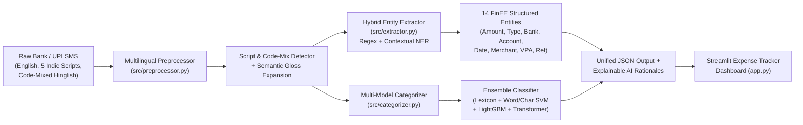

# Robust NLP Framework for Automated Financial Transaction Extraction and Expense Categorization

**School of Computer Science and Engineering — RV University**  
**Team ID: 10**

| Student Name | USN |
| :--- | :--- |
| **Preksha P V** | `1RUA24CSE0331` |
| **Reshma K P** | `1RUA24CSE0363` |
| **Prathik K B** | `1RUA24CSE0327` |
| **Rushil Ravi Reddy** | `1RUA24CSE0380` |

**Project Guides:** Prof. Khushboo Pandey & Prof. Priyanka S Shivaramaiah  
**Dataset:** [`Ranjit0034/finee-dataset`](https://huggingface.co/datasets/Ranjit0034/finee-dataset) (152,000+ Indian Banking & UPI Messages across 6 Indian Languages + Code-Mixed Augmentation)

---

## 🎯 Project Objectives (Aligned with Synopsis)

1. **Automated Financial Entity Extraction:** Programmatically extract structured transaction details (**Transaction Amount, Merchant/Beneficiary Name, Date, Transaction Type [Debit/Credit], Bank Name, Masked Account/Card Number, UPI VPA, Reference ID, and Payment Mode**) from bank and UPI SMS/notification messages.
2. **Automated Expense Categorization:** Classify transactions into fine-grained FinEE categories (`food`, `grocery`, `shopping`, `transport`, `travel`, `bills`, `entertainment`, `healthcare`, `education`, `investment`, `emi`, `transfer`, `salary`) and map them to the **Synopsis Core Categories** (**Food & Dining, Shopping, Travel & Transport, Bills & Utilities, Healthcare, Education, Investments, and P2P Transfers**).
3. **Multilingual & Code-Mixed Support:** Native support for **English (`en`)**, **Hindi (`hi` — हिंदी)**, **Kannada (`kn` — ಕನ್ನಡ)**, **Tamil (`ta` — தமிழ்)**, **Telugu (`te` — తెలుగు)**, **Bengali (`bn` — বাংলা)**, and **Romanized Code-Mixed (`hinglish` / `kanglish` / `tanglish`)** banking messages (e.g., *"Aapke HDFC khate XX4248 se Rs.485.50 kat gaya for Swiggy payment"*).
4. **Automated Personal Expense Tracker & Explainability:** Interactive Streamlit workbench with inline NER span highlighting, Explainable AI (XAI) token attributions, batch ledger analytics, and downloadable CSV expense reports.

---

## 🏗️ System Architecture



---

## 📂 Project Directory Structure

```text
NLP/
├── app.py                          # Interactive Streamlit Expense Tracker & NLP Workbench
├── train_and_evaluate.py           # End-to-End Dataset Loader, Model Trainer & Evaluator
├── requirements.txt                # Project Python dependencies
├── README.md                       # Project documentation and usage guide
├── src/
│   ├── __init__.py
│   ├── config.py                   # Categories, Indian bank aliases, multilingual lexicons
│   ├── preprocessor.py             # Script detection, code-mix detection & text normalization
│   ├── extractor.py                # Hybrid Regex + Contextual NER entity extraction engine
│   ├── data_loader.py              # FinEE HF dataset fetcher + Code-Mixed & Education augmentation
│   ├── categorizer.py              # Rule-based, Subword SVM, LightGBM, Transformer & Hybrid Ensemble
│   └── evaluator.py                # Precision, Recall, F1 & Confusion Matrix evaluation suite
├── notebooks/
│   └── FinEE_NLP_Framework_Walkthrough.ipynb   # Interactive Jupyter Notebook pipeline
├── data/                           # Processed train/valid/test splits & sample CSVs
├── models/                         # Saved trained models (.pkl and fine-tuned weights)
└── outputs/                        # Evaluation JSON report and high-res performance charts
```

---

## 🚀 Quickstart Guide

### 1. Activate Virtual Environment
```bash
source .venv/bin/activate
```

### 2. Run Training & Comprehensive Evaluation
```bash
python train_and_evaluate.py
```
This script:
- Streams/loads the [`Ranjit0034/finee-dataset`](https://huggingface.co/datasets/Ranjit0034/finee-dataset) splits and augments with **Code-Mixed (Hinglish/Kanglish/Tanglish)** and **Education** transactions.
- Trains and saves the **Subword Character + Word N-Gram TF-IDF** models (**Calibrated LinearSVC, Logistic Regression, and LightGBM**) and optional **Multilingual Transformer (MuRIL / XLM-R)**.
- Evaluates both **Entity Extraction (Precision, Recall, F1)** and **Expense Categorization (Accuracy, Macro F1, Weighted F1)** across all languages.
- Saves charts to `outputs/` (`model_comparison.png`, `entity_extraction_f1.png`, `confusion_matrix.png`, `multilingual_performance.png`).

### 3. Launch the Interactive Expense Tracker Dashboard
```bash
streamlit run app.py
```
